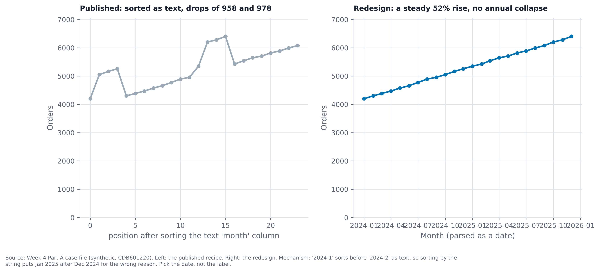
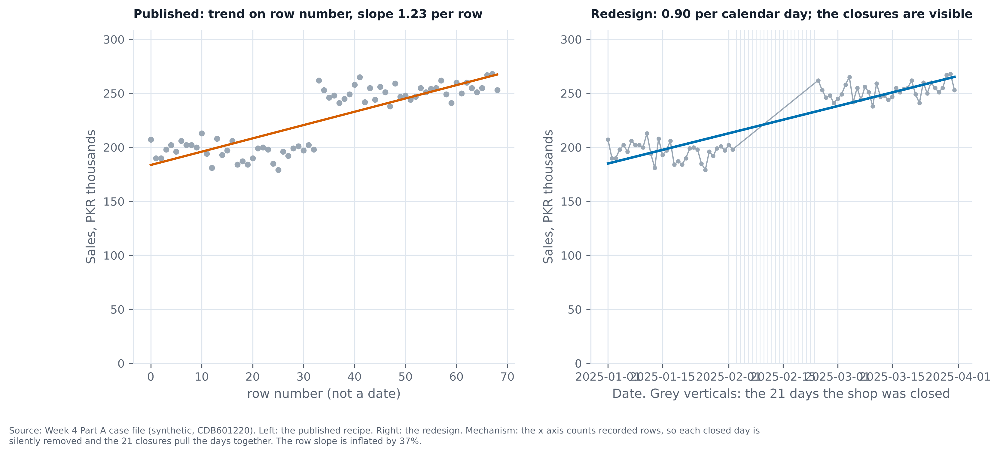
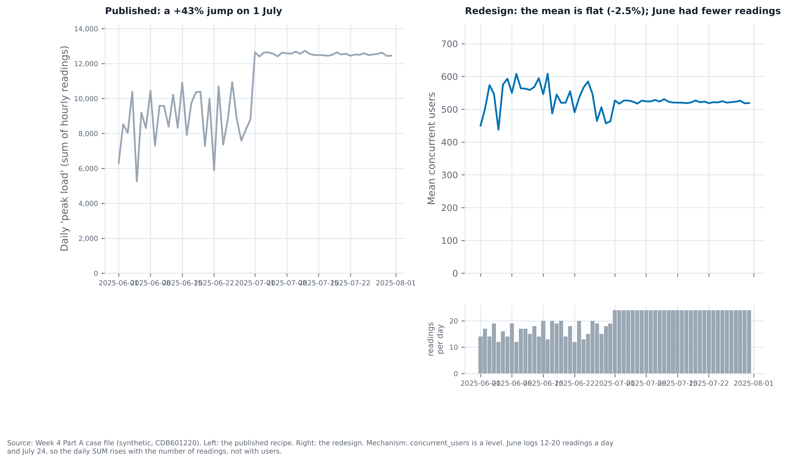
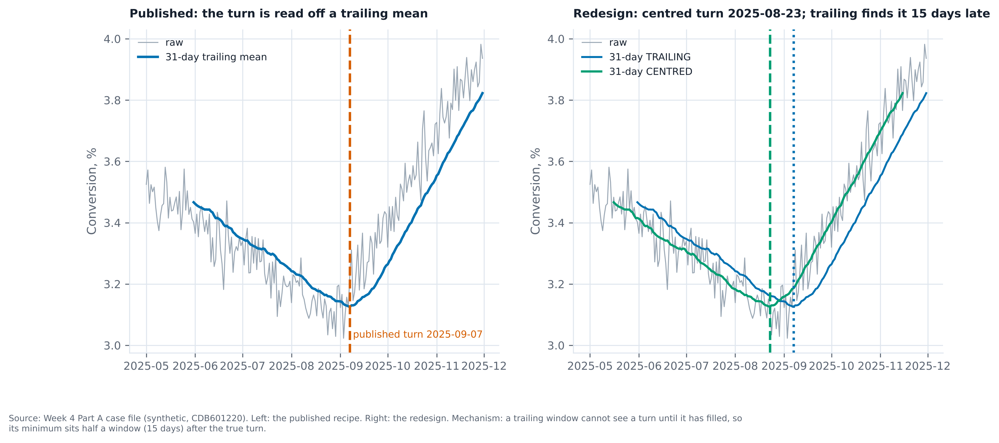
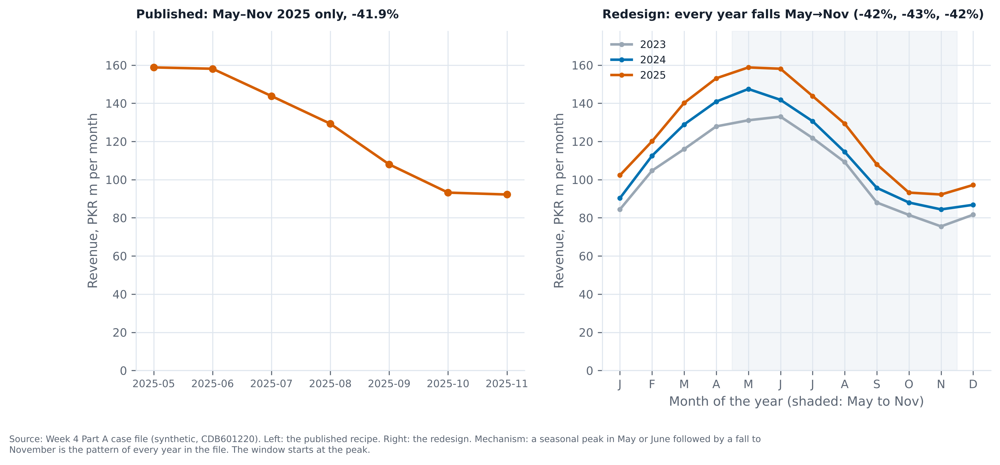
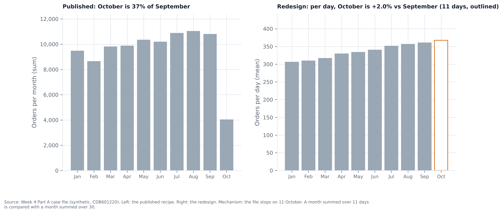
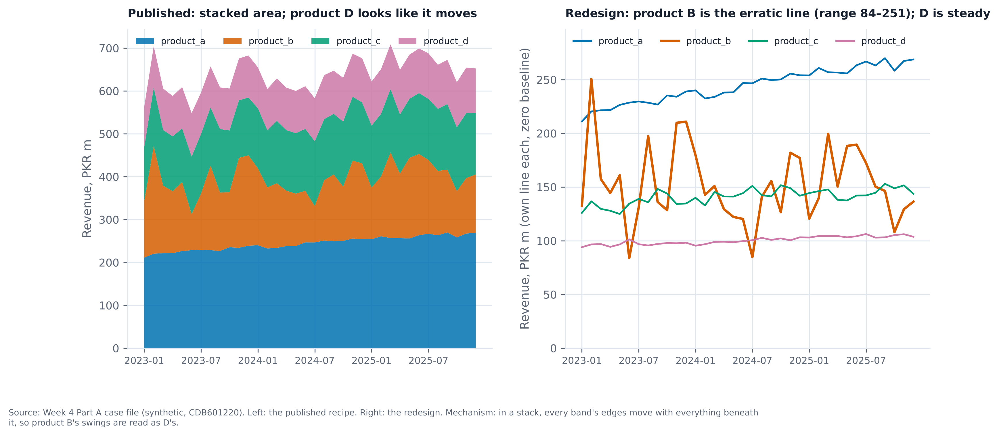
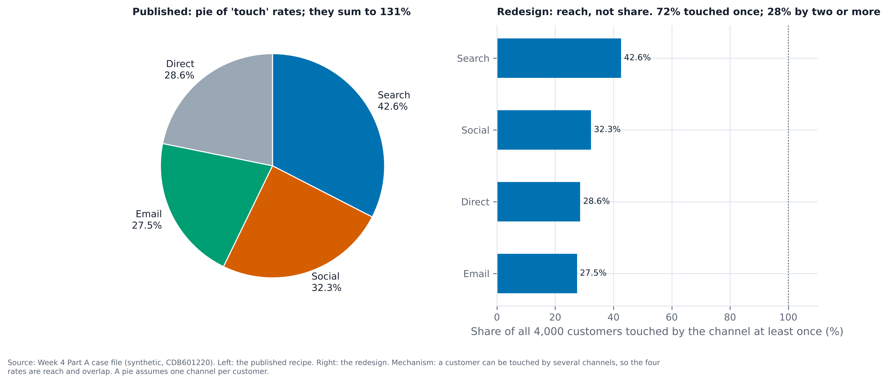
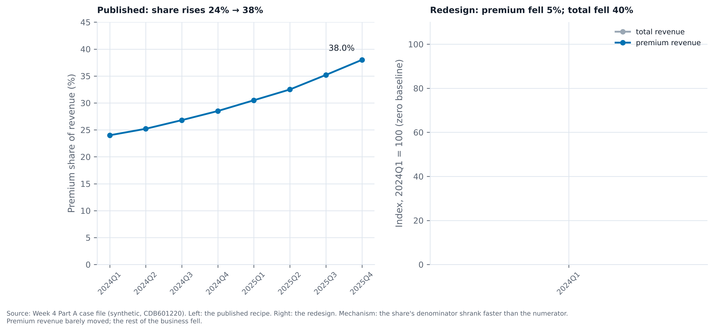

# Part A — Diagnosis of the nine published charts

Each case has a figure, `partA_caseNN.png`: the left panel reproduces the published recipe, the right panel is the redesign. Every number below comes from `partA_charts.py` (printed in `partA_selfcheck.txt`). Data is the synthetic case file, CDB601220.

**Format note:** the brief asks for a PDF. This diagnosis is written as markdown with the figures as PNG, and the PNGs can be exported to PDF on request.

---

## Case 1 — Orders by month, string dates

{width=100%}

- **Conclusion:** the published series shows a collapse that does not exist.
- **Decoy:** the sawtooth drops that look like a seasonal cycle.
- **Mechanism:** months are stored as text ("2024-1", "2024-2"). Sorting the text puts "2024-10" and "2024-11" in the wrong place, so two December-to-January transitions come out as drops of 958 and 978 orders.
- **Number:** parsing the month as a date gives a steady rise from 4,200 to 6,405 orders, +52.5%.
- **Redesign:** parse the month to a date before sorting. Plot the parsed series on a date axis.

## Case 2 — Daily sales with closed days

{width=100%}

- **Conclusion:** the published trend slope is overstated, and the closures are hidden.
- **Decoy:** a clean-looking linear trend on a row-number axis.
- **Mechanism:** the x-axis counts recorded rows. The 21 closed days (three per weekday) are removed silently, so the axis compresses time. The row slope is 1.232 per row; the calendar-day slope is 0.901 per day. The row axis overstates the slope by about 37%.
- **Number:** first to last recorded value 207 to 253, +22.2%.
- **Redesign:** plot against calendar date and show the closed days as gaps or verticals.

## Case 3 — Bandwidth as hourly concurrent users

{width=100%}

- **Conclusion:** the +43% July jump is a counting artefact. The average load is flat.
- **Decoy:** a sudden step on 1 July in the daily total.
- **Mechanism:** `concurrent_users` is a level (how many users are connected at one moment), not a flow. June has 12–20 readings per day and July has 24, so summing readings per day counts more readings in July.
- **Number:** daily sum June mean 8,782, July mean 12,543, +42.8%. Daily mean 535.9 to 522.6, −2.5%.
- **Redesign:** plot the daily mean, and show readings-per-day in a panel beneath it so the coverage change is visible.

## Case 4 — Intervention and conversion

{width=100%}

- **Conclusion:** the turn is in mid-August, not early September.
- **Decoy:** a turn read off a trailing 31-day minimum.
- **Mechanism:** a trailing window cannot see a turn until it has filled, so its minimum falls half a window after the true turn.
- **Number:** trailing minimum on 7 Sep 2025; centred minimum on 23 Aug 2025. Lag = 15 days, which equals half of 31.
- **Redesign:** use a centred window for locating the turn, and say in the caption that the trailing version is for live monitoring only.

## Case 5 — Revenue, May to November 2025

{width=100%}

- **Conclusion:** the May-to-November fall is seasonal, not a 2025 decline.
- **Decoy:** a −41.9% fall in the window shown.
- **Mechanism:** the window starts at the seasonal peak. Every year in the file falls by the same amount from May to November.
- **Number:** 2023 −42.4%, 2024 −42.8%, 2025 −41.9%. November 2025 is 9.3% above November 2024.
- **Redesign:** plot each year on a month-of-year axis and shade May to November, so the repeated pattern is visible.

## Case 6 — Monthly orders, file ends on 11 October

{width=100%}

- **Conclusion:** October looks like a collapse; per day it is about flat.
- **Decoy:** October at 37% of September.
- **Mechanism:** the file stops on 11 October. October is summed over 11 days and September over 30.
- **Number:** October 4,041 over 11 days (367 per day). September 10,805 over 30 days (360 per day). Per day, +2.0%.
- **Redesign:** compare means per day and outline the partial month.

## Case 7 — Stacked area of four products

{width=100%}

- **Conclusion:** product B is the erratic series; D appears to move only because of the stack.
- **Decoy:** the top band of the stack looks as if it is swinging.
- **Mechanism:** in a stacked area, each band's edges shift with every band beneath it.
- **Number:** product B ranges 83.9–250.6 (SD 35.6). Product D ranges 94.0–106.3 (SD 3.6). The total stays inside 548.3–708.7, which matches the brief.
- **Redesign:** plot each product as its own line on a zero baseline, with B highlighted.

## Case 8 — Channel attribution as a pie

{width=100%}

- **Conclusion:** the four channel rates are not shares of customers; they are overlapping reach.
- **Decoy:** a pie that sums to 131%.
- **Mechanism:** a customer can be touched by several channels. 2,895 customers have one touch, 980 have two, 116 have three, 9 have four. Zero customers have no touch.
- **Number:** search 42.6%, social 32.3%, direct 28.6%, email 27.5%. Sum 131.0%. 72.4% touched once; 27.6% touched two or more times.
- **Redesign:** reach bars with a 100% reference, plus the exclusive-combination counts.

## Case 9 — Premium share of revenue

{width=100%}

- **Conclusion:** the premium line did not grow; the denominator shrank.
- **Decoy:** share rising from 24% to 38%.
- **Mechanism:** total revenue fell from 1,000 to 600. Premium revenue went from 240 to 228, a fall of 5%. The share rose because the rest of the business fell faster.
- **Number:** premium share 24.0% to 38.0%. Premium −5.0%; total −40.0%.
- **Redesign:** plot absolute premium revenue, and index total and premium to 2024Q1 = 100 on a zero baseline.

---

## Open points

- Case 3's redesign top-left panel is the published recipe only; the readings-per-day panel sits on the right, so the left side has no bottom panel. This is deliberate.
- Case 6's October outline is a visual cue, not a computed value; the per-day numbers are the evidence.
